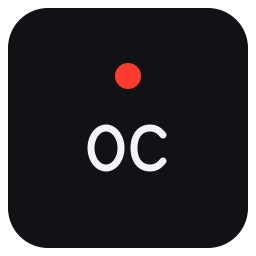
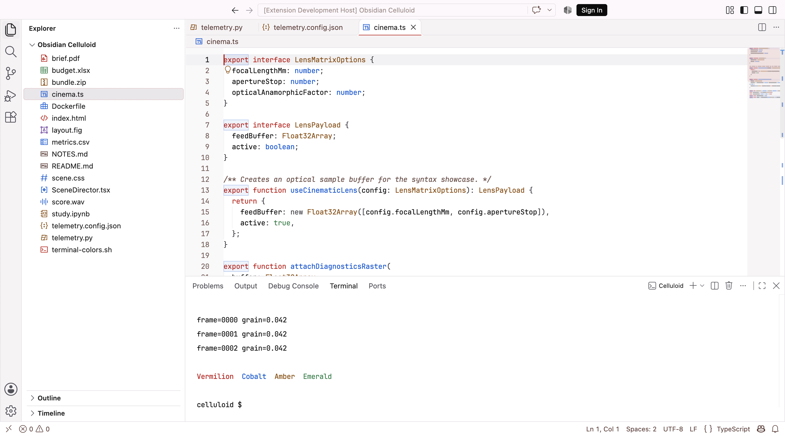
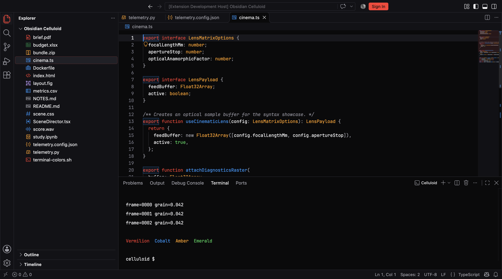

<p align="center"></p>

# Obsidian Celluloid

A cinematic pair of native Visual Studio Code themes with precise syntax colors,
quiet surfaces and original mechanical file icons. Choose studio-light clarity or
near-black Noir. Both share vermilion signals, cobalt symbols and cinema amber.

**Free · MIT licensed · Native themes and SVG file icons · No runtime dependencies**

The intended first public release is **0.3.1**, under Marketplace publisher
**zmmartins**. Source: [GitHub repository](https://github.com/zmmartins/obsidian-celluloid-vscode).
This repository preparation does not publish the extension.

## Light

White code paper, warm chalk chrome, carbon text and restrained red indicators.



## Noir

A deep black code stage, layered near-black chrome, phosphor text, cobalt
functions and amber strings/numbers, with subdued gray comments.



These are real native VS Code workbench captures on macOS, using the optional
settings preset and installed JetBrains Mono. They show sample files in an
isolated Extension Development Host; no custom UI or design mockup is overlaid.

## Install and select

After publication, search **Obsidian Celluloid** in VS Code's Extensions view.
For a downloaded release package, run **Extensions: Install from VSIX…** and
choose `obsidian-celluloid-0.3.1.vsix`.

1. Run **Preferences: Color Theme** and select **Obsidian Celluloid (Light)** or
   **Obsidian Celluloid Noir**. On macOS, use **⌘K, ⌘T** to open the picker.
2. Run **Preferences: File Icon Theme** and select **Obsidian Celluloid Icons**.

The CLI alternative for a configured release package is:

```sh
code --install-extension obsidian-celluloid-0.3.1.vsix
```

VS Code 1.95 or newer is required. Selecting a theme does not change fonts,
layout, sidebar visibility or your existing settings.

## File icons

The shared icon theme contains **45 original 16px glyphs**, **129 extension
associations** and specific filename mappings. Related formats share coherent
silhouettes; contrast-selected variants adapt automatically between Light and Noir.

| Family | Examples |
| --- | --- |
| Documents and office | PDF, DOC/DOCX, PPT/PPTX, XLS/XLSX, TXT, RTF, Markdown |
| Structured data and config | JSON/JSONC, YAML, TOML, XML, CSV/TSV, INI, ENV |
| Code and web | JS/JSX, TS/TSX, HTML/CSS variants, Python, Java, C/C++/C#, PHP, Ruby, Go, Rust, Kotlin, Swift, shell |
| Tooling | Dockerfile, Makefile, Gradle, Maven, package manifests, lockfiles, Git and EditorConfig |
| Archives and media | ZIP/RAR/7z/TAR/GZ/TGZ, images, audio and cinematic video |
| Design and research | FIG/Sketch/XD/AI/PSD, IPYNB, SQL, logs, certificates and keys |

PDF, archives, CSV, Dockerfile, SQL and notebooks have distinct glyphs. Unknown
formats intentionally keep a generic file icon. Read the [file icon coverage
notes](docs/FILE-ICONS.md) for association details.

## Optional typography

Install [JetBrains Mono](https://www.jetbrains.com/lp/mono/), then manually merge
only the settings you want from either preset:

- [Light typography and layout](presets/obsidian-celluloid.settings.json)
- [Noir typography and layout](presets/obsidian-celluloid-noir.settings.json)

Both recommend **13px JetBrains Mono**, **20px editor rows**, regular weight,
compact native layout and the existing terminal sizing. Menlo/Monaco provide
macOS fallbacks. No fonts are bundled or downloaded, and presets are never
applied by the extension. Merge keys into your existing settings; do not replace
the entire file.

For optional switching with the macOS or Windows appearance, manually merge:

```json
{
  "window.autoDetectColorScheme": true,
  "workbench.preferredLightColorTheme": "Obsidian Celluloid (Light)",
  "workbench.preferredDarkColorTheme": "Obsidian Celluloid Noir"
}
```

This uses [VS Code's native appearance settings](https://code.visualstudio.com/docs/configure/themes#_automatically-switch-based-on-os-color-scheme).
The [appearance preset](presets/obsidian-celluloid-auto.settings.json) contains the
same opt-in snippet. High contrast preferences remain separate.

## Native by design

Obsidian Celluloid themes editor/workbench colors, TextMate scopes, semantic
tokens and file icons through official VS Code contributions. It creates no
webviews, dashboards, decorative telemetry or additional panels. Native controls
retain VS Code's Codicons. Workbench typography, glass blur, glow, grain overlays
and custom control geometry remain outside the theme API.

Semantic colors depend on the active language provider. Python semantic
highlighting needs a provider; TextMate fallback works without one. ANSI colors
can also act as terminal backgrounds, so terminal applications may affect their
final appearance.

## Credits and license

Original theme source, mechanical SVG glyphs and the reconstructed OC logo are
licensed under [MIT](LICENSE), copyright Jose Maria Pereira. The OC logo was
rebuilt as editable vector geometry from the project owner's supplied reference;
it is not an enlarged screenshot. Visual direction comes from the project's
Google Stitch references. Those reference materials are not distributed in the VSIX.

[JetBrains Mono](https://www.jetbrains.com/lp/mono/) supplies the recommended code
font; the extension does not redistribute it. Visual Studio Code and its native
UI belong to Microsoft. No third-party icon packs or brand-logo artwork are used.
See [asset provenance](docs/ASSET-PROVENANCE.md).

Developers and release maintainers can use the [release guide](docs/RELEASE.md).
